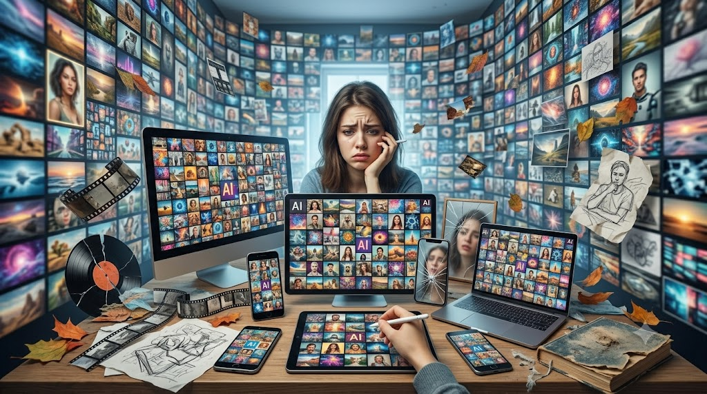
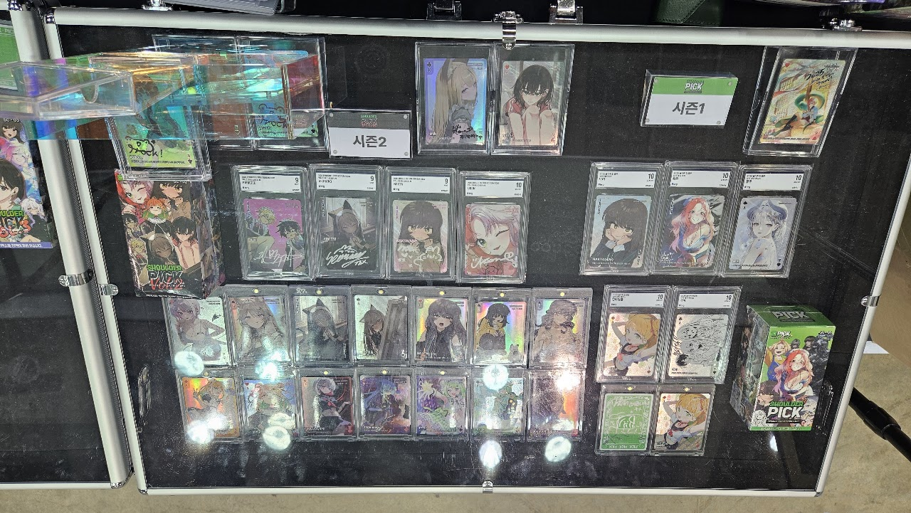

*AI가 이미지를 쏟아내는 시대, 사람은 지쳐간다.(Generated by Gemini)*

## 이미지가 '공짜'가 된 시대

생성형 AI는 그림을 그리는 방식을 완전히 바꿔놓았습니다. 2025년 3월 ChatGPT의 '지브리풍 이미지' 유행을 시작으로, 이제 누구나 몇 초 만에 그럴듯한 일러스트를 만들어냅니다. 실제로 소비자 조사에서 'AI 일러스트·애니풍 이미지'를 접해봤다는 응답은 **93%**에 달했습니다. 우리가 매일 보는 이미지 상당수가 이미 AI의 손에서 나온 셈입니다.

그림이 흔해지고, 만드는 비용이 사실상 '공짜'에 가까워졌습니다. 그런데 바로 이 지점에서 흥미로운 역설이 시작됩니다.

## 사람들은 '진짜'를 원한다

이미지가 넘쳐날수록, 소비자는 오히려 'AI가 만든 것'에 피로와 거리감을 느끼기 시작했습니다.

소비자 데이터 플랫폼 픽플리가 전국 성인 1,000명을 조사한 결과, AI 생성 콘텐츠에 거부감을 느낀다는 응답이 **46.2%**였습니다. 특히 AI를 가장 능숙하게 다루는 **20대의 거부감이 53.8%**로 가장 높았습니다. 거부감의 가장 큰 이유는 완성도나 어색함이 아니라, **"감정과 진정성이 느껴지지 않아서"(30.9%)**였습니다.

기업과 소비자의 온도 차도 뚜렷합니다. 미국 광고업계 단체 IAB 조사에 따르면, 업계 임원의 82%가 "젊은 소비자도 AI 광고를 좋아할 것"이라 기대했지만 실제로 호감을 표한 소비자는 45%에 그쳤습니다. 기대와 반응의 격차는 37%p로, 1년 전(32%p)보다 더 벌어졌습니다. 소비자들은 기업이 AI를 쓰는 이유가 '더 좋은 것을 주기 위해서'가 아니라 '비용을 아끼기 위해서'라는 사실을 읽어냅니다.

메시지는 분명합니다. 무엇이든 쉽게 만들어지는 시대일수록, 사람들은 **누군가가 진심으로 만들어낸 '진짜'**에 더 큰 가치를 둡니다.

## 그래서, 손으로 '소유'하고 싶어진다

이 진정성에 대한 갈증은 곧 **실물을 소유하려는 욕구**로 이어집니다. 화면 속에 무한히 복제되는 이미지와 달리, 손에 쥘 수 있는 '한 점'은 아무나 가질 수 없는 특별함을 지니기 때문입니다.

*화면 속 이미지와 달리, 실물은 '소유'와 '수집'의 대상이 된다.*

실제로 지금 대한민국은 '굿즈 열풍'에 빠져 있습니다. 서울경제에 따르면 젊은 세대는 굿즈를 통해 자신의 취향과 신념을 드러내는 '정체성 소비'에 열광하고, 국립중앙박물관의 '뮷즈'부터 아트토이까지 소장 가치를 지닌 상품이 완판 행렬을 이룹니다. 특히 주목할 것은 작가가 직접 부스를 지키는 **'아티스트 중심' 아트페어**의 부상입니다. 올해 7회째를 맞은 어반브레이크는 글로벌 아트토이 페어와 손잡고 15개국 355명의 작가를 한자리에 모았고, 예술가가 만든 한정판 아트토이를 사려는 컬렉터들로 붐볐습니다.

이 행사의 총괄 디렉터는 이렇게 말합니다. "예술가의 창작이 IP와 브랜드, 시장으로 확장될 때 창작도 지속 가능해진다." 사람이 그린 작품이 실물 굿즈로 이어질 때, 그 가치는 팬에게는 '소장의 기쁨'이, 작가에게는 '지속 가능한 수익'이 된다는 뜻입니다.

## 작가의 그림이, 팬의 손에 닿기까지

정리하면 이렇습니다. AI가 이미지를 쏟아낼수록 사람이 그린 그림은 더 귀해지고, 팬들은 그 그림을 실물로 소유하고 싶어 합니다. 이 흐름은 창작자에게 분명한 기회입니다. 문제는 작가의 그림이 팬의 손에 닿기까지의 '연결'입니다.

비랩트(BeRapt)는 바로 그 연결을 만듭니다.

**숄더픽(ShoulderPick)**은 '한국형 픽시브(pixiv)'이자 '일러스트계의 유튜브'를 지향하는 서브컬처 이미지 전문 오픈 플랫폼입니다. 영상 크리에이터가 영상을 올리는 것만으로 유튜브에서 수익을 기대하듯, 작가도 그림을 업로드하는 것만으로 수익과 기회를 기대할 수 있게 합니다. AI가 아니라 사람이 그린 그림, 그리고 그 그림을 아끼는 팬이 만나는 공간입니다.

나아가 숄더픽은 작가들의 작품을 팬들에게 '굿즈'로 제공할 수 있는 다양한 방법을 개발하고 있습니다. '진짜 사람이 그린 그림을 손에 쥐고 싶다'는 바로 그 욕구에 응답하기 위한 새로운 기능들을 곧 선보일 예정이니 기대해 주세요. 여기에 **숄더(Shoulder)**는 팬이 좋아하는 작가를 월정기 구독으로 후원하는 응원 커뮤니티로, 팬심을 꾸준한 수입으로 잇습니다.

AI가 무엇이든 만들어내는 시대이기에, 사람이 그린 그림의 온기는 더욱 특별해집니다. 비랩트는 그 온기를 알아보는 팬과 그것을 그려내는 작가를 잇고, 작가가 마음껏 그릴 수 있는 생태계를 만들어갑니다. 진짜의 가치를 아는 사람들이 늘어날수록, 그 진짜를 만드는 작가도 함께 빛날 테니까요.

---

## 참고 자료

- [픽플리 — AI 생성 콘텐츠 소비자 트렌드 데이터](https://pickply.com/blog/AI-generated-content-consumer-trends-2026)
- [ZDNet코리아 — IAB, AI 광고에 대한 기업·소비자 인식 격차 조사](https://zdnet.co.kr/view/?no=20260119150938)
- [서울경제 — 낙서도 장난감도 '컬렉션'이 되는 시대](https://www.sedaily.com/article/20067199)
